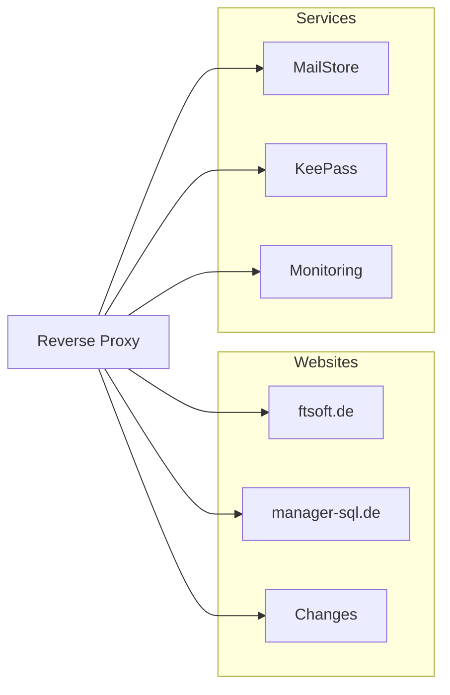

# Übersicht Services

**Voraussetzungen:**
Reverse Proxy
Linux Server 
	warum Linux? Keine Lizenzkosten, bessere Dockerunterstützung
	Server härten, zb SSH nur Key
**Entscheidungen:**
- Welcher Reverse Proxy -> evtl als gegeben ansehen
- welcher Linux Server
- welches Monitoring Tool
	- Muss-Anforderungen
-> Nutzwertanalysen
**Einbindung beim Kunden:**
- virtuell auf Server?
- nur Agents die senden?
- Kombo?
- Je nach Kunde
- komplette Trennung am saubersten, Agent vor Ort muss Skripte ausführen können zb für api abfragen oder Soap/rest
**Anforderungen:**
- Mandantenfähig
- geringe bis keine Lizenzkosten
- Senden der Metriken über HTTPS
**Auswahl der Metriken**

**Ausblick**
- Skripte für schnelle Einrichtung
- Alloy Snippets vorbereiten für gängige Geräte